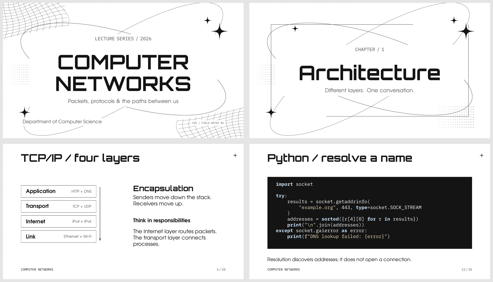

# y2k-beamer

A reusable monochrome Beamer theme for technical lectures and presentations,
with a light default for classroom projection and an optional dark appearance.



Four slides from the Computer Networks demo, rendered with LuaLaTeX using the
default light appearance and Orbitron headings. Build the
[editable demo](examples/demo.tex) with `make` to produce `build/demo.pdf`.

Oversized space-age headings, editorial italics, four-point sparkles, thin orbital
rings and warped vector meshes give the cover and dividers their identity.
Content slides retain clear margins, readable body text and quiet decoration.
Content uses side margins of 7.5% of the page width, a 6 mm top inset and
footer text at least 5.5 mm above the bottom edge. Body text defaults to 10 pt
with 12 pt line spacing, and frame headings to 20 pt. Cover metadata follows
the same side margins; full-bleed image layouts intentionally fill the page.

The [20-slide Computer Networks demo](examples/demo.tex) exercises the full system.
All theme decoration and demo illustrations are original TikZ vectors. The
three supplied design references informed the visual direction; their images
are not embedded or redistributed.

## License

The original theme, graphics, examples, scripts and documentation are licensed
under the GNU General Public License, version 3 (GPL-3.0-only). See [LICENSE](LICENSE)
for the complete terms.

The bundled, unmodified Orbitron font retains its SIL Open Font License;
see [assets/fonts/OFL.markdown](assets/fonts/OFL.markdown) and its
[provenance](assets/fonts/README.md).

## Dependencies

Target: TeX Live 2026 on Linux. LuaLaTeX is preferred; pdfLaTeX is supported with
a TeX Gyre heading fallback. Required TeX packages: `beamer`, `pgf`, `listings`,
`tex-gyre`, `plex`, `fontspec` (LuaLaTeX), `standalone` and `booktabs` (demo).
Build with GNU Make and `latexmk`. Checks additionally require Python 3 and
Poppler's `pdfinfo`, `pdftotext` and `pdffonts`. No shell escape, Python syntax
highlighter or external image downloads are needed to build.

On Void Linux, use the distribution's `texlive-bin` and `poppler-utils` packages,
then install missing TeX packages through the TeX Live setup you use. See the
[Void TeX Live handbook](https://docs.voidlinux.org/config/texlive.html).
For an upstream TeX Live installation, for example:

```sh
tlmgr install beamer pgf listings tex-gyre plex fontspec standalone booktabs latexmk
command -v lualatex latexmk kpsewhich
kpsewhich beamer.cls
```

Your TeX Live must include the LuaHBTeX engine and a `lualatex` format to use
LuaLaTeX. Package and format installation permissions depend on your TeX setup;
the theme installer itself needs no root access.

## Build from the repository

```sh
make                         # LuaLaTeX when present, otherwise pdfLaTeX
make demo ENGINE=lualatex    # explicitly choose the preferred engine
make demo ENGINE=pdflatex    # portable fallback
make check                   # compile fixtures and exercise installation
make clean                   # remove only build/
```

The default target creates `build/demo.pdf`. Generated illustrations, logs and
auxiliary files also stay in `build/`. `make check` rejects box warnings, missing
glyphs and package warnings; verifies page counts, embedded fonts and PDF text;
compiles dark/light and 16:9/4:3/16:10 fixtures; and tests copy/link installation,
outside-repository compilation and uninstall in temporary TEXMFHOME trees.

The Makefile exports TeX-native `TEXINPUTS` paths for root theme files, example
inputs, generated assets and the bundled font. Its final colon preserves TeX's
normal package search paths. The `.latexmkrc` files also configure these paths
for direct latexmk use, including inside `examples/`.
After `make` has generated the demo illustrations,
you can also compile directly inside `examples/`:

```sh
cd examples
latexmk -lualatex -interaction=nonstopmode -halt-on-error demo.tex
```

`LATEXMK` and `ENGINE` are Make variables; both expect an executable name or path.
The demo's networking commands are illustrative and are not executed by builds.

## Install for any presentation

```sh
make install                         # copies to the user's TEXMFHOME
make install INSTALL_MODE=link       # development symlinks to this checkout
kpsewhich -var-value TEXMFHOME
kpsewhich beamerthemeY2K.sty
make uninstall
```

The installer places the five Beamer modules, graphics package, Orbitron font
and both project and font licenses in `TEXMFHOME/tex/latex/y2k-beamer`. It refreshes the filename
database when `mktexlsr` is available and verifies discovery with `kpsewhich`
outside the repository. It refuses to overwrite an unmanaged directory and
uninstalls only manifest-listed files. Link installations require the checkout
to remain at its original location. Use `TEXMFHOME=/path/to/tree make install`
to target a separate tree. `sh scripts/install.sh --help` shows the interface.

## Minimal presentation

```tex
\documentclass[aspectratio=169,11pt]{beamer}
\usetheme[light,decoration=subtle,typography=space]{Y2K}
\title[NETWORKS]{COMPUTER\\NETWORKS}
\subtitle{A packet's journey}
\author{Your name}
\date{2026}
\begin{document}
\begin{frame}[plain]\titlepage\end{frame}
\section{Architecture}
\YTwoKSection[Different layers. One conversation.]
\begin{frame}{Transport layer}
  \begin{YTwoKDefinition}{TCP}
    A reliable, ordered byte-stream transport.
  \end{YTwoKDefinition}
  \begin{itemize}
    \item<1-> Retransmission
    \item<2-> Flow and congestion control
  \end{itemize}
\end{frame}
\YTwoKConclusion{Keep exploring.}{Follow the packet, then explain the path.}
\end{document}
```

## Options

Load-time options use `\usetheme[...]{Y2K}`. Runtime changes use
`\YTwoKSetup{...}`; group them with braces to limit them to selected frames.

| Purpose | Theme option | Runtime key | Default |
| --- | --- | --- | --- |
| Appearance | `dark` or `light` | `appearance=dark/light` | light |
| Decoration | `decoration=none/subtle/full` | same | subtle |
| Major headings | `typography=space/editorial` | same | space |
| Footer text | `footer=true/false` | same | true |
| Frame numbers | `numbering=true/false` | same | true |
| Fine vector grain | `grain=true/false` | same | true |
| Optional highlight | `accent=RRGGBB` | same | follows foreground |

Aspect ratio belongs to Beamer: `\documentclass[aspectratio=43]{beamer}`,
`aspectratio=169` or `aspectratio=1610`. Background graphics track `\paperwidth`
and `\paperheight`. Choose content dimensions appropriate to the available
space; the theme does not shrink overflowing content automatically.

Default light colors: background `FFFFFF`, secondary `F2F2F2`, foreground
`141414`, muted `595959`, border `666666`. The optional dark appearance uses
background `141414`, secondary `252525`, foreground `FFFFFF` and muted `BFBFBF`.
Accent affects `\alert`, highlighted text and warning
titles. Choose an accent with sufficient contrast against your selected surface.
Code remains on charcoal in either appearance. Its pale blue keywords and
warm strings are restrained exceptions to the otherwise monochrome palette.

For a dense frame:

```tex
{\YTwoKBackgroundOff
\begin{frame}{A detailed table}
  % Regular Beamer content
\end{frame}}
```

This disables content decoration and grain. Hero layouts intentionally manage
their own canvas; use `decoration=none` to remove their motifs too.

## Layouts and components

All content commands work inside ordinary Beamer frames unless marked below.
Overlays, equations, figures, tables, hyperlinks and bibliography retain native
Beamer behavior. `plain` frames suppress furniture. Section dividers are explicit,
so sections can also be used without inserting an extra slide.

| Interface | Use |
| --- | --- |
| `\titlepage` in a `[plain]` frame | Cover with title, subtitle, author, date and institute |
| `\YTwoKSection[subtitle]` | Creates a plain divider using the current section |
| Normal `frame` with title | Standard content or a TikZ diagram |
| `\YTwoKColumns[.6][alignment]{left}{right}` | Two columns, ratio in `(0,1)`, open gutter; alignment defaults to `T` (top), or use `c` (center) |
| `\YTwoKComparison{left title}{left body}{right title}{right body}` | Two-sided comparison |
| `YTwoKCode[language=Python]` | Solid, borderless code block, in a `[fragile]` frame |
| `\YTwoKInputCode[language=Python]{file.py}` | Same solid code block for an external file |
| `\YTwoKImage[caption]{file}{width}{height}` | Centered cover crop with a thin frame |
| `\YTwoKFullBleed[caption]{file}` | Creates a plain frame with an edge-to-edge crop |
| `\YTwoKQuestion{number}{question}` | Prominent question heading |
| `YTwoKOptions` | A/B/C-style choices |
| `\YTwoKConclusion{heading}{message}` | Creates an editorial closing frame |
| `thebibliography` / normal bibliography | References with quiet metadata and linked citations |
| `\YTwoKProfile[diameter]{image}{name}{description}` | Circular cover crop and member text |
| `YTwoKDefinition`, `YTwoKExample`, `YTwoKWarning`, `YTwoKCallout` | Each takes a required title; body follows in the environment |
| `\YTwoKHeading{text}` | Decorative heading inside content |
| `\YTwoKHighlight{text}` | Bold, optionally accented text |
| `\YTwoKSeparator` | Vertical spacing between content groups, without a rule |
| `\YTwoKProgress` | Optional vector progress line; add explicitly where desired |

Image widths/heights must be TeX dimensions (`5cm`, `\linewidth`); use PDF, PNG
or JPEG. Crops preserve proportions and clip the center, so prepare a different
crop externally when the subject needs a different focal point. Empty profile
descriptions are accepted. In a narrow layout, reduce portrait diameter and
spacing. Keep code environments outside arguments to column commands: native
Beamer `columns`/`column` environments accommodate verbatim content.

Use `\YTwoKColumns[.6][c]{diagram}{explanation}` to vertically center a
standalone diagram or image beside taller text. Keep the default top alignment
when text underneath an image should align with the neighboring content.

For two images side by side, put one image in each column:

```tex
\YTwoKColumns{\YTwoKImage[Before]{before.png}{\linewidth}{3cm}}
             {\YTwoKImage[After]{after.png}{\linewidth}{3cm}}
```

```tex
\begin{frame}[fragile]{Inspect the routes}
  \begin{YTwoKCode}[language=bash,numbers=none]
ip -brief address
ip route
  \end{YTwoKCode}
\end{frame}
```

Listings supports `Python`, `C`, `bash`, `SQL` and the theme's `Y2KConfig`.
Pass ordinary listings options to `YTwoKCode`, or use `\YTwoKInputCode[language=Python]{file.py}`
for external files. Each block has one continuous background with padding and
no frame or row rules. Line numbers are disabled by default; pass `numbers=left`
to enable them. The `Y2K` listings style sets syntax and typography; use these
wrappers to supply its background. For non-ASCII code, use LuaLaTeX and configure listings'
`literate` mappings as needed. Minted is optional and outside the default build;
if you choose it, configure its execution requirements yourself.

### Vector primitives

These commands draw **inside a TikZ picture**. Their optional argument accepts
TikZ scope options; their mandatory argument is a parenthesized coordinate.
Primitives use unit coordinates, so `scale`, `xscale`, `yscale`, `rotate`,
`draw`, `fill` and `opacity` control their appearance.

```tex
\begin{tikzpicture}
  \YTwoKStar[fill=y2kFg,scale=.3]{(0,0)}
  \YTwoKOrbit[draw=y2kMuted,scale=1.5]{(2,0)}
  \YTwoKMesh[draw=y2kBorder]{(4,-.5)}
  \YTwoKHalftone[fill=y2kMuted]{(6,-.5)}
  \YTwoKCorner[draw=y2kBorder,rotate=20]{(8,-.5)}
\end{tikzpicture}
```

Stars span `(-1,-1)` to `(1,1)`, orbits have a unit major radius, and meshes and
halftone fields occupy the unit square. Grain is deterministic, not raster noise.
The design uses silver outlines and highlights to suggest metal without large
gradient fills. Decorations are clipped to the page and kept out of the teaching
area; content and accessibility always take priority over adding another motif.

## Fonts

LuaLaTeX uses bundled **Orbitron Bold** for space headings, **TeX Gyre Adventor**
for body text, and **IBM Plex Mono** for `\texttt`, code and technical labels.
Editorial mode replaces the
display face with **TeX Gyre Bonum Bold Italic**, echoing the decorative serif
lettering in the references. All are open-source fonts.

Orbitron comes from [The League of Moveable Type](https://github.com/theleagueof/orbitron)
under the [SIL Open Font License](assets/fonts/OFL.markdown). It is shipped as an
unmodified OTF. TeX Gyre is distributed under the
[GUST Font License](https://ctan.org/pkg/tex-gyre). If Orbitron is unavailable,
LuaLaTeX falls back to Adventor. pdfLaTeX uses Adventor, Bonum and IBM Plex Mono
through their TeX packages. No system font installation is needed.

Override display typography after loading the theme with standard LaTeX, e.g.
`\renewcommand{\YTwoKDisplayFont}{\sffamily\bfseries}`. With LuaLaTeX,
`\setsansfont` and `\setmonofont` can customize the body and code faces.

## Structure

`beamerthemeY2K.sty` owns options and assembly; `beamercolorthemeY2K.sty` owns
palettes; `beamerfontthemeY2K.sty` owns fonts; `beamerinnerthemeY2K.sty` owns
layouts and content commands; `beamerouterthemeY2K.sty` owns titles, margins and
footer; `y2kgraphics.sty` owns original reusable vector motifs.
`examples/demo.tex` is presentation content, separate from the theme.
`examples/assets/` contains editable vector illustration sources.

## Troubleshooting and visual QA

- **Theme not found:** run `kpsewhich beamerthemeY2K.sty`. Use `make` during
  development or install the theme before compiling elsewhere. Preserve the
  final colon in `TEXINPUTS`.
- **LuaLaTeX missing:** install the engine/format for your TeX distribution or
  use `make ENGINE=pdflatex`. A first LuaLaTeX run may initialize its font cache.
- **Dependency errors:** `make` names missing executables or TeX files. Install
  the corresponding packages, then rebuild.
- **Box warnings:** shorten text, split a slide, reduce a diagram's dimensions,
  or choose a wider aspect ratio. Long headings wrap; cover headings work best
  as one or two deliberate lines. A theme cannot guarantee fit for arbitrary text.
- **Verbatim error:** mark the frame `[fragile]` and keep listings outside
  macro arguments. End the listing and frame on separate lines.
- **Changed engine:** `make ENGINE=...` runs latexmk with the requested engine;
  `make clean` removes old outputs if switching distributions or formats.

To inspect your own slides, render them after compiling:

```sh
mkdir -p build/preview
pdftoppm -png -scale-to 1200 build/demo.pdf build/preview/slide
```

Inspect full slides for collisions, clipped diagrams, crop composition and
contrast. `make check` verifies compilation and behavior, not artistic quality.
The supplied demo was also rendered and visually reviewed; see
[QA.md](QA.md) for the tested environment and results.
